<div align="center">

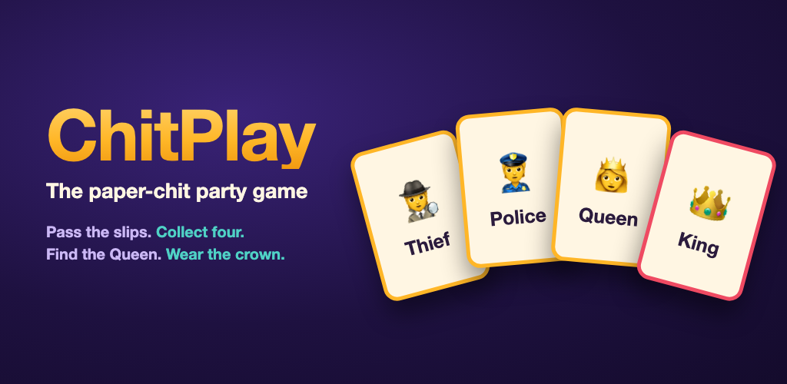

# ChitPlay

**The paper-chit party game, on everyone's phone.** Pass folded slips, collect four of a kind, find the Queen and wear the crown.
English movies by default, Telugu (and all-Indian) movies one tap away. Real-time, cheat-proof multiplayer for 3–10 friends, built with Flutter and Firebase.

<a href="https://play.google.com/store/apps/details?id=com.chandra.chittilata"></a>

[](https://github.com/ChandraChaan/chittilata/actions/workflows/ci.yml)
[](https://play.google.com/store/apps/details?id=com.chandra.chittilata)
[](https://github.com/ChandraChaan/chittilata/releases/latest)


[](LICENSE)

[**Google Play**](https://play.google.com/store/apps/details?id=com.chandra.chittilata) · [How to play](docs/HOW_TO_PLAY.md) · [Video walkthrough](docs/media/chittilata-how-to-play.mp4) · [Architecture](docs/ARCHITECTURE.md)

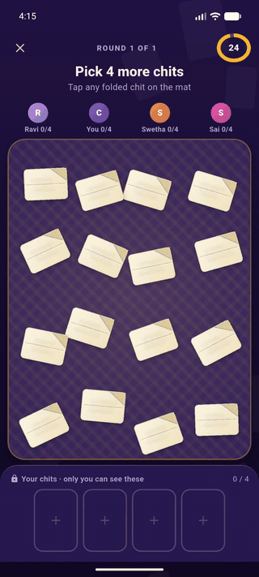

</div>

## Why ChitPlay?

Paper-chit games like *Chittilu Aata* (చిట్టిలాట) and *Raja Rani* are a staple of family gatherings across India, but they need paper, a pen and everyone in one room. ChitPlay (formerly Chittilata) keeps the feel of real paper: chits are written, folded, shuffled and scattered on a mat, and you pick them with your finger. It also adds what paper can't do: a fair dealer, a referee that can't be fooled, timers, and scores that add themselves up.

## Three games

| 🎬 **Movie Chits** · 3–10 players | 👑 **King & Queen** · 4–10 players | 🎭 **Dumb Charades** · 3–10 together |
|---|---|---|
| Each player picks four folded movie chits. Slips travel one at a time around a random circle, and the first to hold **four of a kind** wins the round. Everyone else picks a secret character chit: **Queen 800 · Police 500 · Thief 100**. After several rounds the top two are crowned **King** and **Queen**. | Everyone picks one folded role chit: **King, Queen, Police, Thief**, plus Minister, Commander and more for bigger groups. The King must find the Queen, the Queen finds the next role, and so on down the chain. **A wrong guess swaps roles.** Everyone scores the role they end with. | One player secretly gets a movie and **acts it out without a word**. Everyone else picks the title from six on their phone, one guess each. The fastest right guess scores most, and the actor scores too. Everyone takes turns acting. |
| [Full rules →](docs/GAME_RULES.md) | [Full rules →](docs/KING_QUEEN_RULES.md) | [Full rules →](docs/CHARADES_RULES.md) |

## Screenshots

<table>
  <tr>
    <td>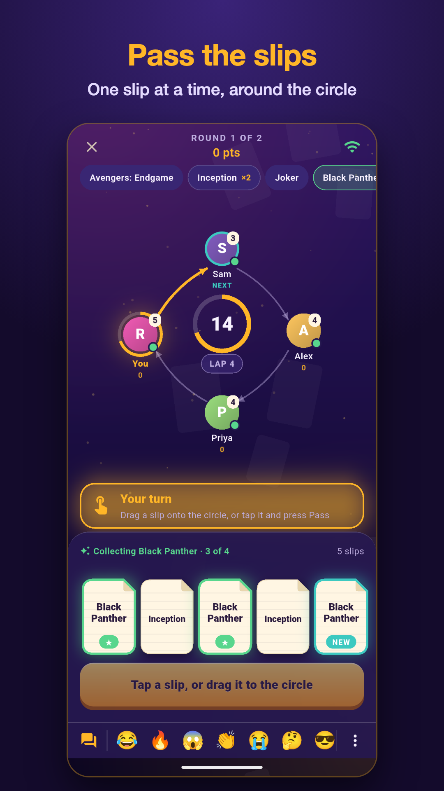</td>
    <td>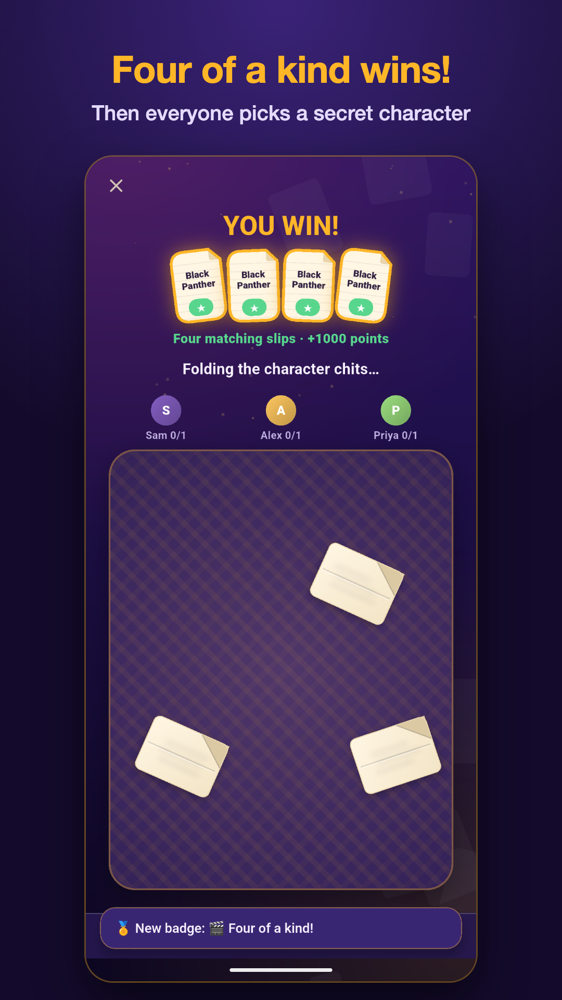</td>
    <td>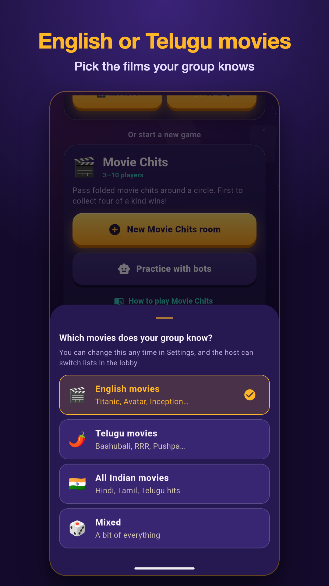</td>
    <td>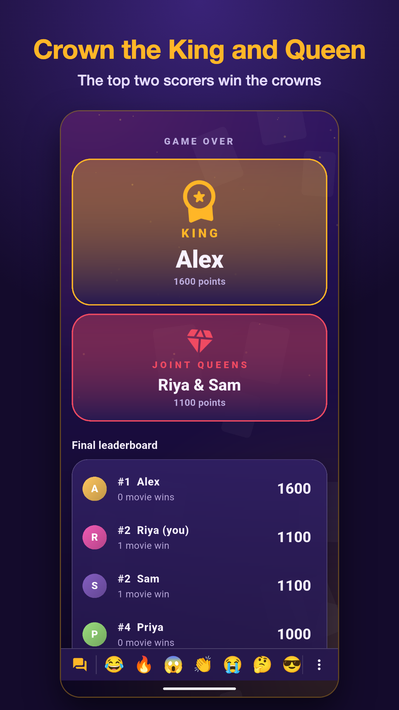</td>
  </tr>
  <tr>
    <td>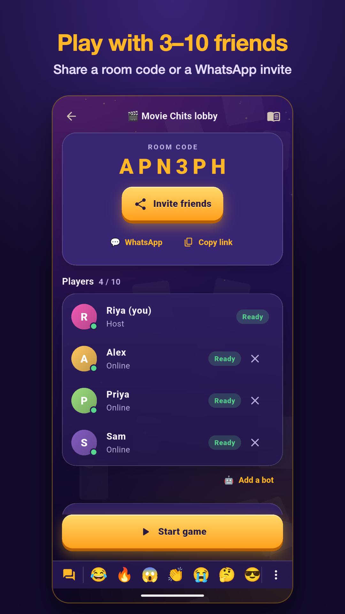</td>
    <td>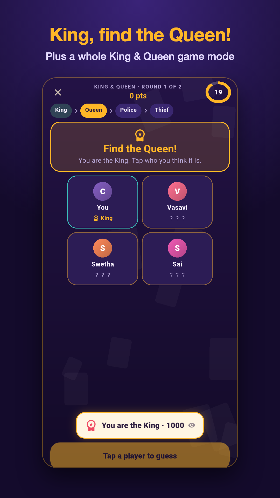</td>
    <td>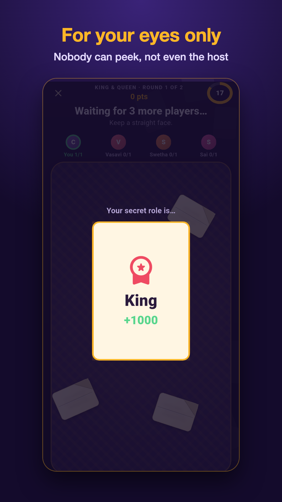</td>
    <td>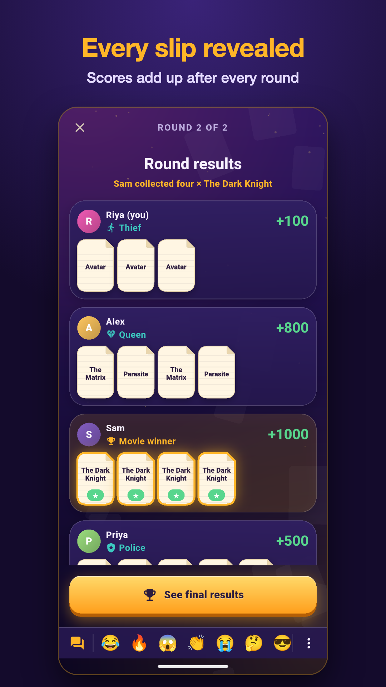</td>
  </tr>
</table>

## Features

- 🎬 **Your movies, your language.** English movies by default; switch to Telugu, all-Indian, mixed or your own custom names (cities, cricketers, anything) when you create a room or in the lobby.
- 📜 **Real paper feel.** Chits are written, folded, gathered and scattered on a woven mat, with a private unfold when you pick one. Paper sounds and haptics included, and reduced-motion settings are respected.
- 🔒 **Nobody can peek, not even the host.** Your hand and your role live in documents only you can read. Undealt slips and sealed chits sit where no client can read them at all.
- ⚖️ **Fair by construction.** Shuffles use cryptographic randomness, and the deal never gives anyone three copies of a name at the start. Every pick, pass and guess is checked on the server.
- ⏱️ **Timers that keep the game moving.** Every deadline lives on the server, so all phones count down together.
  - **Picking chits:** you have 1 minute. Any chit you haven't picked is then picked for you at random, which can't change your chances.
  - **Passing and guessing:** never done for you automatically. When time runs out, your phone buzzes and the others can nudge you 👋. After 45 more seconds, or if your phone is offline, someone at the table can choose to play for you, and the server makes that move fairly.
- 💬 **Room chat.** One-tap emoji reactions and fun preset lines (English first, with Telugu classics) float up on everyone's screen, plus a chat panel with the room's history and, in rooms of friends, short typed messages. Quick-match tables with strangers stay preset-only.
- 🛡️ **Safe chat.** Abusive words are masked on every phone (disguised spellings too), anyone can be muted or reported with a long-press, and typed messages can be switched off in Settings.
- 🎛️ **Host controls, anytime.** End the game for everyone, warn a silent player (they get a minute to respond, then anyone's phone can remove them; two warnings allow an immediate removal), and let friends join a running game from the next round. Players can leave at any time.
- 🤷 **No stalemates.** Four laps of passing with no winner? The host ends the round and everyone draws a character chit, King included.
- 🔁 **Reconnect and resume.** Close the app mid-round and come back to exactly where you were. Changed phones? Watch the game and ask the host for your seat back.
- 🤖 **Practice with bots**, 🌐 **quick match** with players online, and 📨 **invite links** that open the app straight into the room.
- 🔔 **Turn notifications** when the app is closed, never while you're watching the game.
- 😀 **Profiles, levels and badges**, 👥 **friend groups** with a monthly leaderboard, and 🪔 **festival themes** for Sankranti, Ugadi and Diwali.
- 🤝 **Ties handled gracefully.** Tied for King? Vote for a tie-breaker round or share the crown.
- 🎵 **Sound, music and haptics.** A festive menu theme and in-game groove, crisp button clicks, whooshes, chimes and a victory fanfare, plus vibration patterns for your turn and wins. Each has its own switch in Settings.
- 🎨 **Polished, responsive UI.** A night-sky theme with gold 3D buttons, light and dark modes, confetti and round reveals, and a history of past games. Every screen is tested on small phones, tablets and up to 200% text size.
- ⬆️ **Update prompts.** One setting in Firestore can show an optional "New version available" card or block very old builds, using Google Play's in-app update.

## How it stays cheat-proof

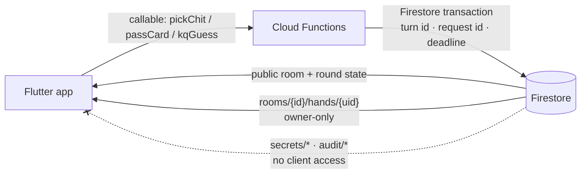

- Clients **never write game state**. Every move is a server transaction validated against the current turn, with idempotency keys so retries are safe and racing requests resolve to exactly one winner.
- [`firestore.rules`](firestore.rules) is least-privilege, and emulator tests check it by trying to read other players' hands and roles and expecting to be refused.
- The rules engine is pure TypeScript ([`functions/src/engine`](functions/src/engine)) with property tests over thousands of random games.

More detail: [docs/ARCHITECTURE.md](docs/ARCHITECTURE.md).

## Tech stack

| Layer | Tech |
|---|---|
| App | Flutter 3.44 / Dart 3.12, Android (minSdk 24) |
| Backend | Firebase Anonymous Auth, Cloud Firestore, Cloud Functions v2 (Node 22, TypeScript), Cloud Messaging, Hosting (invite links), region `asia-south1` |
| Quality | 182 backend tests (engine, security rules, transactions on the emulator), 259 Flutter unit, widget and layout tests, GitHub Actions CI |
| Ops | Crashlytics (Dart + NDK), Firebase App Distribution, signed and R8-optimised release builds |

## Install

ChitPlay is live on **[Google Play](https://play.google.com/store/apps/details?id=com.chandra.chittilata)** (Android 7.0 or later). Invite links (`chittilata-game.web.app/join/CODE`) open the app straight into a room, or the Play Store if it isn't installed yet.

Signed APKs are also attached to each [GitHub release](https://github.com/ChandraChaan/chittilata/releases/latest) for testing. They are signed with the upload key, so they can't update a Play install (uninstall first); everyone else should use Google Play.

## Develop

```bash
flutter pub get
flutter run                      # talks to the deployed Firebase backend
flutter analyze && flutter test  # Flutter unit + widget tests
```

```bash
cd functions && npm ci
npm test                         # game-engine unit tests
npm run test:emulator            # security rules + transactions (needs Java 21 for the Firestore emulator)
```

### Play with bots

The quickest way to try a game on your own is in the app: tap **Practice with bots** under Movie Chits or King & Queen on the home screen, or **Add a bot** in any lobby.

For scripted end-to-end runs, [`functions/scripts/bots.mjs`](functions/scripts/bots.mjs) adds bot players that use the same callables and rules as the app:

```bash
cd functions
node scripts/bots.mjs --code ABC234 --count 3                    # bots join your Movie Chits room
node scripts/bots.mjs --mode kq --code ABC234 --count 3          # bots join your King & Queen room
node scripts/bots.mjs --create --count 4 --rounds 2              # headless game with conservation checks
```

### Use your own Firebase project

1. Create a Firebase project (the Blaze plan is required for Cloud Functions) and enable Anonymous Auth, Firestore, Cloud Messaging and Hosting.
2. Run `flutterfire configure` to regenerate `lib/firebase_options.dart` and `android/app/google-services.json`, and update `.firebaserc`.
3. For invite links, change the host in `android/app/src/main/AndroidManifest.xml` and `lib/core/services/invite_links.dart`, and put your signing certificates' SHA-256 fingerprints in `hosting/public/.well-known/assetlinks.json`.
4. Deploy the backend: `firebase deploy --only functions,firestore:rules,firestore:indexes,hosting`.

### Project layout

```
lib/                   Flutter app (core/ theme + services, data/ models + repository, game/ controller, ui/)
functions/src/engine   Pure TypeScript game rules (deal, exchange, characters, scoring, kingqueen)
functions/src/game     Firestore transactions behind each callable (ops.ts, kq.ts, charades.ts, groups.ts, public.ts) and push triggers (push.ts)
functions/scripts      bots.mjs: scripted bot players for end-to-end runs
firestore.rules        Least-privilege security rules
hosting/public         Invite-link pages and Android App Links (assetlinks.json)
test/, functions/test  Flutter tests, engine tests, emulator security and integration tests
docs/                  Rules, architecture, store assets, media
```

## Documentation

- **Players:** [How to play](docs/HOW_TO_PLAY.md) · [Movie Chits rules](docs/GAME_RULES.md) · [King & Queen rules and state model](docs/KING_QUEEN_RULES.md) · [Dumb Charades rules](docs/CHARADES_RULES.md) · [Video walkthrough](docs/media/chittilata-how-to-play.mp4)
- **Developers:** [Architecture & security](docs/ARCHITECTURE.md) · [Release checklist](docs/RELEASE_CHECKLIST.md) · [Changelog](CHANGELOG.md)
- **Store:** [Play submission guide](docs/store/PLAY_SUBMISSION.md) · [Listing](docs/store/LISTING.md) · [Data Safety](docs/store/DATA_SAFETY.md) · [Privacy policy](docs/PRIVACY_POLICY.md)

## Contributing

Ideas, bug reports and pull requests are welcome. New movie packs and regional variants are especially welcome. See [CONTRIBUTING.md](CONTRIBUTING.md). To report a security issue, please follow [SECURITY.md](SECURITY.md) rather than opening a public issue.

If ChitPlay brought back memories of family game nights, consider giving it a ⭐. It helps other people find it.

## Notes

`google-services.json` and `firebase_options.dart` contain Firebase client identifiers, which ship inside every Android app. They are not secrets: access is enforced by Firestore rules and server-side checks. Signing keys and service accounts are never committed.

## License

[MIT](LICENSE) © 2026 Chandra
