<div align="center">

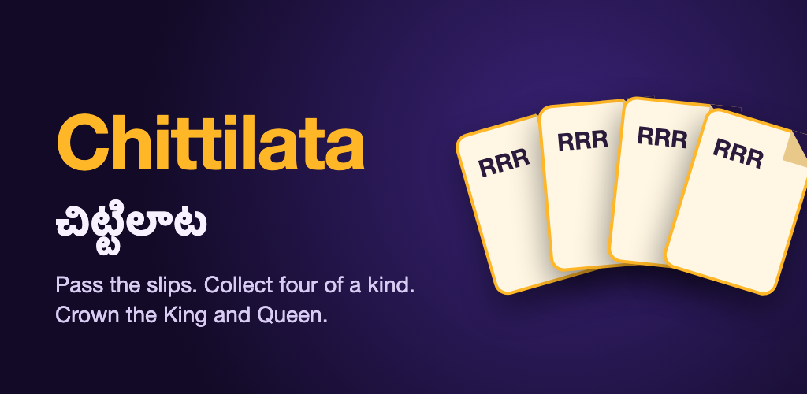

# Chittilata (చిట్టిలాట)

**The Telugu paper-chit games you grew up with, now on everyone's phone.**
Real-time, cheat-proof multiplayer for 3–10 friends, built with Flutter and Firebase.

[](https://github.com/ChandraChaan/chittilata/actions/workflows/ci.yml)
[](https://github.com/ChandraChaan/chittilata/releases/latest)


[](LICENSE)

[**Download**](https://github.com/ChandraChaan/chittilata/releases/latest) · [How to play](docs/HOW_TO_PLAY.md) · [Video walkthrough](docs/media/chittilata-how-to-play.mp4) · [Architecture](docs/ARCHITECTURE.md)

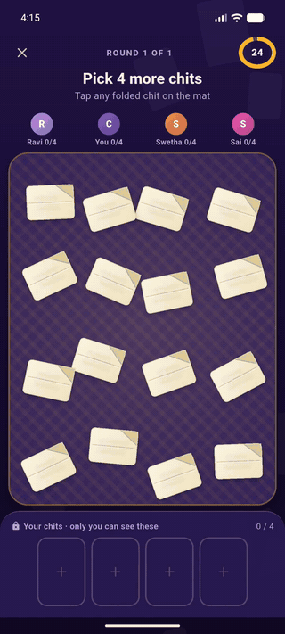

</div>

## Why Chittilata?

Paper-chit games like *Chittilu Aata* and *Raja Rani* are a staple of Telugu family gatherings, but they need paper, a pen and everyone in one room. Chittilata keeps the feel of real paper: chits are written, folded, shuffled and scattered on a mat, and you pick them with your finger. It also adds what paper can't do: a fair dealer, a referee that can't be fooled, timers, and scores that add themselves up.

## Two games

| 🎬 **Movie Chits** · 3–10 players | 👑 **King & Queen** · 4–10 players |
|---|---|
| Each player picks four folded movie chits. Slips travel one at a time around a random circle, and the first to hold **four of a kind** wins the round. Everyone else picks a secret character chit: **Queen 800 · Police 500 · Thief 100**. After several rounds the top two are crowned **King** and **Queen**. | Everyone picks one folded role chit: **King, Queen, Police, Thief**, plus Minister, Commander and more for bigger groups. The King must find the Queen, the Queen finds the next role, and so on down the chain. **A wrong guess swaps roles.** Everyone scores the role they end with. |
| [Full rules →](docs/GAME_RULES.md) | [Full rules →](docs/KING_QUEEN_RULES.md) |

## Screenshots

<table>
  <tr>
    <td>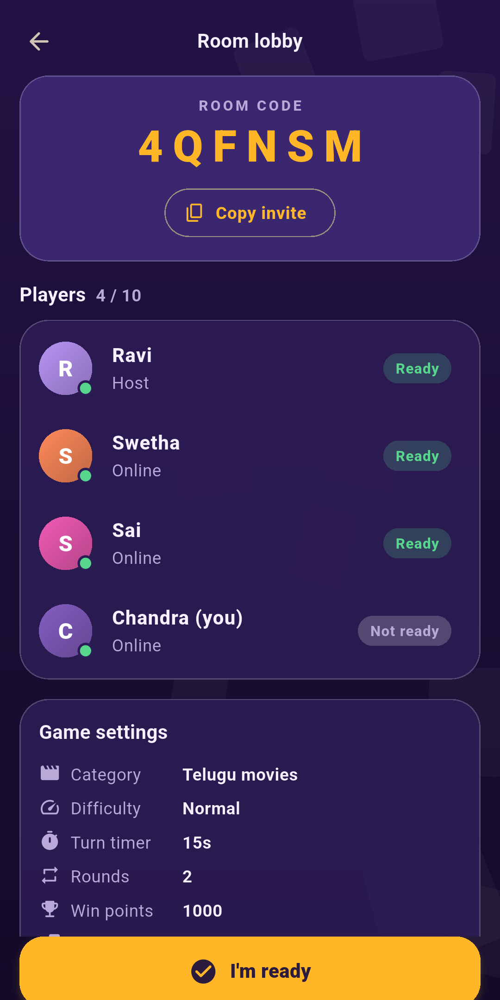</td>
    <td>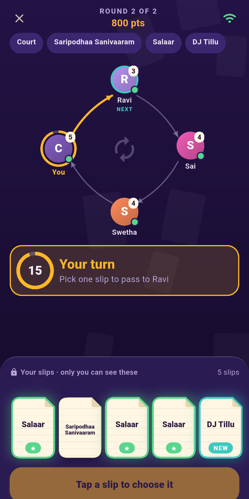</td>
    <td>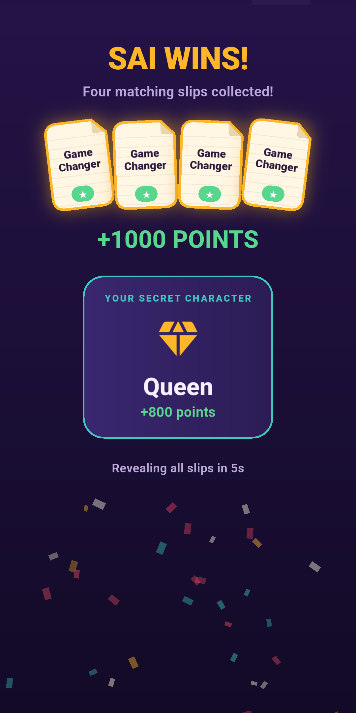</td>
    <td>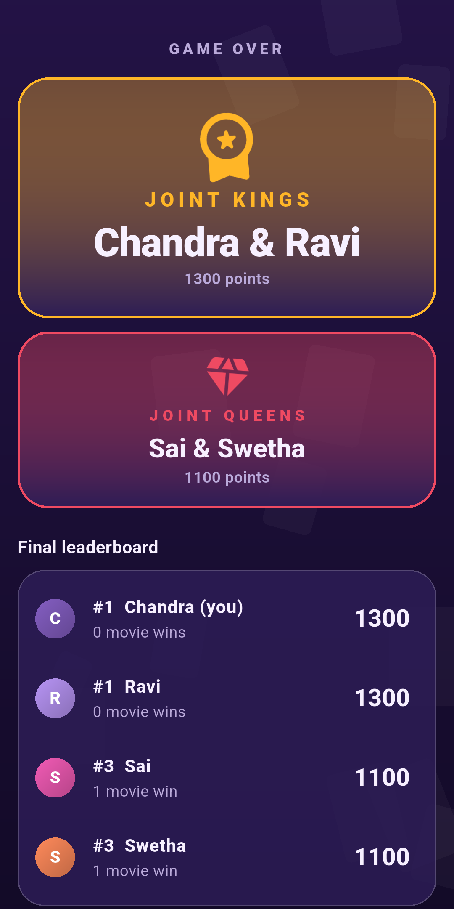</td>
  </tr>
  <tr>
    <td align="center"><sub>Lobby with a shareable code</sub></td>
    <td align="center"><sub>Pass one slip at a time</sub></td>
    <td align="center"><sub>Four of a kind wins</sub></td>
    <td align="center"><sub>Crown the King and Queen</sub></td>
  </tr>
  <tr>
    <td>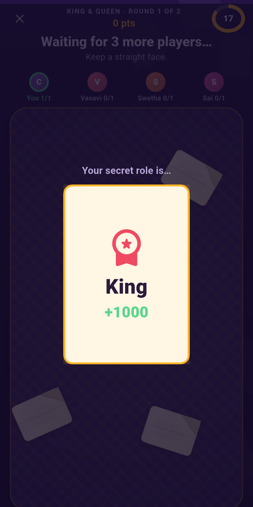</td>
    <td>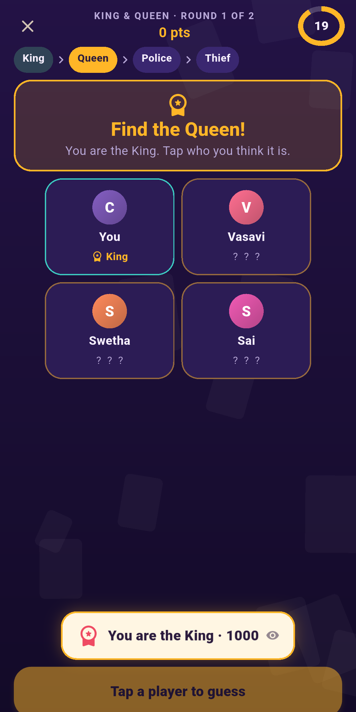</td>
    <td>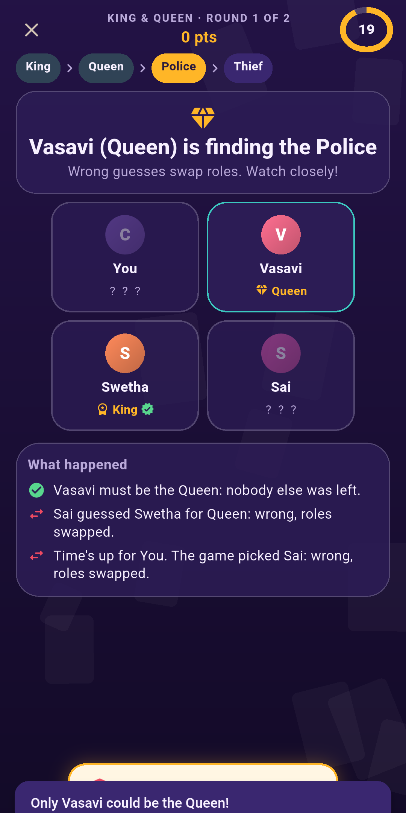</td>
    <td>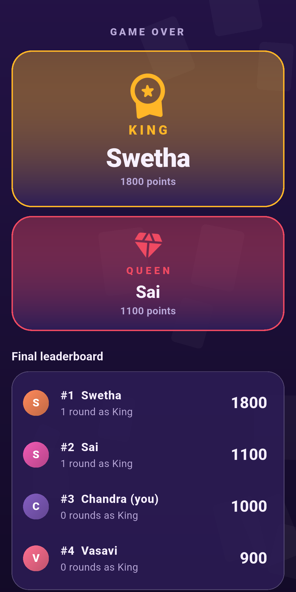</td>
  </tr>
  <tr>
    <td align="center"><sub>Your role, for your eyes only</sub></td>
    <td align="center"><sub>King, find the Queen!</sub></td>
    <td align="center"><sub>Wrong guess? Swap roles</sub></td>
    <td align="center"><sub>Final standings</sub></td>
  </tr>
</table>

## Features

- 📜 **Real paper feel.** Chits are written, folded, gathered and scattered on a woven mat, with a private unfold when you pick one. Paper sounds and haptics included, and reduced-motion settings are respected.
- 🔒 **Nobody can peek, not even the host.** Your hand and your role live in documents only you can read. Undealt slips and sealed chits sit where no client can read them at all.
- ⚖️ **Fair by construction.** Shuffles use cryptographic randomness, and the deal never gives anyone three copies of a name at the start. Every pick, pass and guess is checked on the server.
- ⏱️ **Timers that never play for you.** Turn deadlines live on the server. When time runs out, the late player's phone buzzes and everyone else can nudge them 👋. Only after 45 seconds, or if their phone is offline, can someone at the table choose to play for them, and the server makes that move fairly.
- 💬 **Quick chat.** One-tap emojis and preset phrases in Telugu and English float up on everyone's screen. Presets only, so there's no free text to moderate.
- 🔁 **Reconnect and resume.** Close the app mid-round and come back to exactly where you were.
- 🤝 **Ties handled gracefully.** Tied for King? Vote for a tie-breaker round or share the crown.
- 🎨 **Polished UI.** Light and dark themes, confetti, round reveals, history of past games, and an Android app icon and store assets.

## How it stays cheat-proof

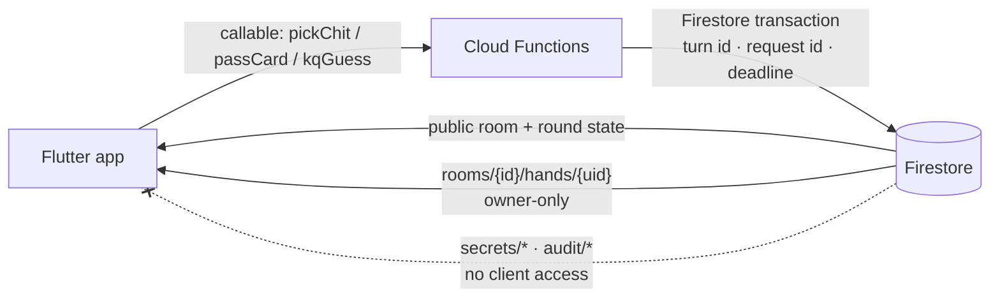

- Clients **never write game state**. Every move is a server transaction validated against the current turn, with idempotency keys so retries are safe and racing requests resolve to exactly one winner.
- [`firestore.rules`](firestore.rules) is least-privilege, and emulator tests check it by trying to read other players' hands and roles and expecting to be refused.
- The rules engine is pure TypeScript ([`functions/src/engine`](functions/src/engine)) with property tests over thousands of random games.

More detail: [docs/ARCHITECTURE.md](docs/ARCHITECTURE.md).

## Tech stack

| Layer | Tech |
|---|---|
| App | Flutter 3.44 / Dart 3.12, Android (minSdk 24) |
| Backend | Firebase Anonymous Auth, Cloud Firestore, Cloud Functions v2 (Node 22, TypeScript), region `asia-south1` |
| Quality | 126 backend tests (engine, security rules, transactions on the emulator), 33 Flutter unit and widget tests, GitHub Actions CI |
| Ops | Crashlytics (Dart + NDK), Firebase App Distribution, signed and R8-optimised release builds |

## Install

Download the APK from the [latest release](https://github.com/ChandraChaan/chittilata/releases/latest). Most phones need `chittilata-<version>-arm64-v8a.apk`; if unsure, use the `universal` APK. Check it against `SHA256SUMS.txt`, then allow installs from your browser or file manager.

## Develop

```bash
flutter pub get
flutter run                      # talks to the deployed Firebase backend
flutter analyze && flutter test  # Flutter unit + widget tests
```

```bash
cd functions && npm ci
npm test                         # game-engine unit tests
npm run test:emulator            # security rules + transactions (needs Java 21 for the Firestore emulator)
```

### Play with bots

[`functions/scripts/bots.mjs`](functions/scripts/bots.mjs) adds bot players that use the same callables and rules as the app. It's handy for trying the game on your own:

```bash
cd functions
node scripts/bots.mjs --code ABC234 --count 3                    # bots join your Movie Chits room
node scripts/bots.mjs --mode kq --code ABC234 --count 3          # bots join your King & Queen room
node scripts/bots.mjs --create --count 4 --rounds 2              # headless game with conservation checks
```

### Use your own Firebase project

1. Create a Firebase project (the Blaze plan is required for Cloud Functions) and enable Anonymous Auth and Firestore.
2. Run `flutterfire configure` to regenerate `lib/firebase_options.dart` and `android/app/google-services.json`, and update `.firebaserc`.
3. Deploy the backend: `firebase deploy --only functions,firestore:rules`.

### Project layout

```
lib/                   Flutter app (core/ theme + services, data/ models + repository, game/ controller, ui/)
functions/src/engine   Pure TypeScript game rules (deal, exchange, characters, scoring, kingqueen)
functions/src/game     Firestore transactions behind each callable (ops.ts, kq.ts)
firestore.rules        Least-privilege security rules
test/, functions/test  Flutter tests, engine tests, emulator security and integration tests
docs/                  Rules, architecture, store assets, media
```

## Documentation

- **Players:** [How to play](docs/HOW_TO_PLAY.md) · [Movie Chits rules](docs/GAME_RULES.md) · [King & Queen rules and state model](docs/KING_QUEEN_RULES.md) · [Video walkthrough](docs/media/chittilata-how-to-play.mp4)
- **Developers:** [Architecture & security](docs/ARCHITECTURE.md) · [Release checklist](docs/RELEASE_CHECKLIST.md) · [Changelog](CHANGELOG.md)
- **Store:** [Listing](docs/store/LISTING.md) · [Data Safety](docs/store/DATA_SAFETY.md) · [Privacy policy draft](docs/PRIVACY_POLICY.md)

## Contributing

Ideas, bug reports and pull requests are welcome. New movie packs and regional variants are especially welcome. See [CONTRIBUTING.md](CONTRIBUTING.md). To report a security issue, please follow [SECURITY.md](SECURITY.md) rather than opening a public issue.

If Chittilata brought back memories of family game nights, consider giving it a ⭐. It helps other people find it.

## Notes

`google-services.json` and `firebase_options.dart` contain Firebase client identifiers, which ship inside every Android app. They are not secrets: access is enforced by Firestore rules and server-side checks. Signing keys and service accounts are never committed.

## License

[MIT](LICENSE) © 2026 Chandra
